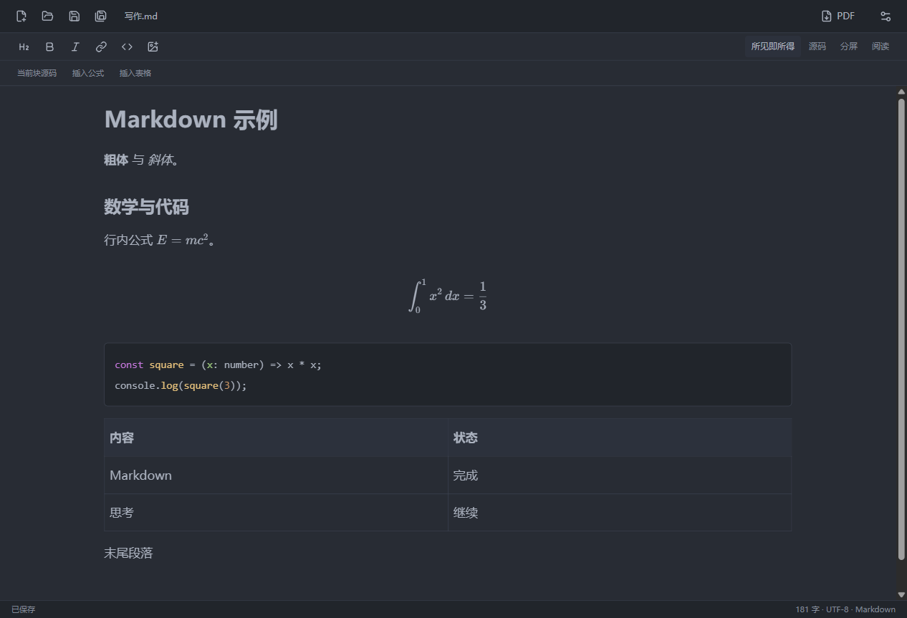

# YMarkdownG

桌面 Markdown 编辑器，支持 Windows、macOS 和 Linux。

[下载](https://github.com/Okazaki-Yumemi/YMarkdownG/releases/latest) · [开发说明](docs/DEVELOPMENT.md)



[分屏](docs/images/split.png) · [设置](docs/images/settings.png)

## 功能

- 所见即所得、源码、分屏预览和阅读模式
- 代码高亮、LaTeX 公式、图片粘贴
- 平滑光标、输入反馈
- 主题、自定义背景和透明度
- PDF 导出

直接打开本地 `.md` 文件。没有笔记库、文件夹收录或目录管理。
再次打开文件会复用现有窗口；有未保存内容时先询问。

## 使用

| 快捷键                 | 操作                 |
| ---------------------- | -------------------- |
| Ctrl / Cmd + N         | 新建                 |
| Ctrl / Cmd + O         | 打开                 |
| Ctrl / Cmd + S         | 保存                 |
| Ctrl / Cmd + Shift + S | 另存为               |
| Ctrl / Cmd + Shift + E | 导出 PDF             |
| Ctrl / Cmd + ,         | 设置                 |
| Ctrl / Cmd + Shift + F | 专注模式             |
| Alt + Enter            | 编辑当前块源码       |
| Ctrl / Cmd + Enter     | 应用块源码           |
| Esc                    | 取消块源码或退出专注 |

未保存的更改在切换文件或退出前会询问。图片粘贴到 Markdown 同目录；未命名文档会先要求选择保存位置。

工具栏上的 PDF 按钮导出当前文档。设置支持隐藏文件栏、格式栏和状态栏。

## 开发

需要 Node.js 22.12+。

```sh
npm ci
npm run dev
npm test
npm run build
npm run test:desktop
```

```sh
npm run package:win
npm run package:mac
npm run package:linux
```

## 说明

- v0.6.0 移除了文件管理和内置更新。旧版创建的文件保留在原位置，可直接打开；新版不自动加载旧笔记库。
- 当前使用手动保存。外部修改会在窗口重新获得焦点时检查；本地有未保存内容时保留双方内容并阻止直接覆盖。
- 所见即所得会尽量保留未改动块的写法，复杂 Markdown 不保证逐字往返。
- 本地图片支持 PNG、JPEG、GIF、WebP，预览范围为当前文档目录及其子目录。
- 发行包暂未签名，macOS 未公证。Windows 已做实际运行测试；macOS/Linux 通过原生 CI 构建。

[第三方许可](THIRD_PARTY_NOTICES.md)
