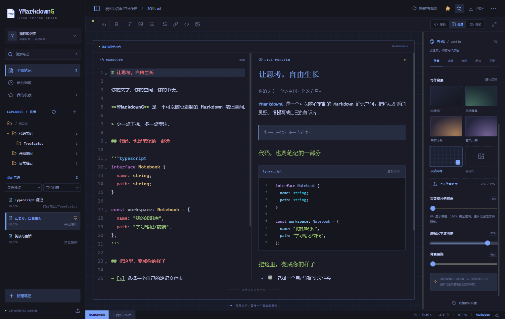
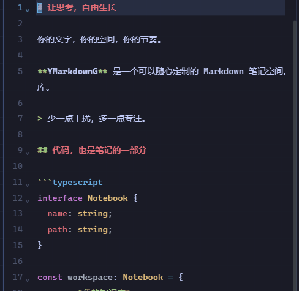
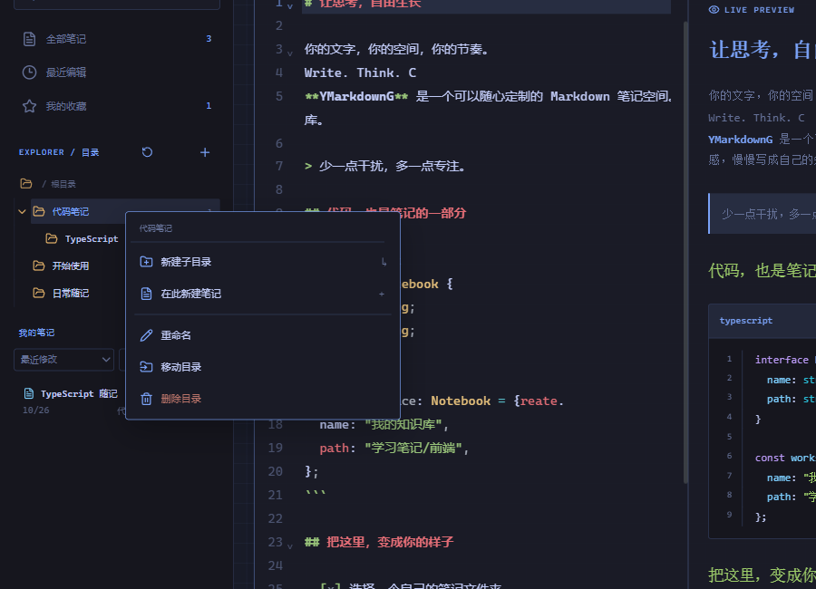

<div align="center">


# YMarkdownG

**让思考，自由生长。**

一个可以随心定制的桌面 Markdown 笔记空间。<br/>
Neovim 的视觉风格 · 即时预览 · 你的本地文件

[](https://github.com/Okazaki-Yumemi/YMarkdownG/releases/latest)
[](https://github.com/Okazaki-Yumemi/YMarkdownG/actions/workflows/release.yml)


**[下载桌面版](https://github.com/Okazaki-Yumemi/YMarkdownG/releases/latest)** · [功能与演示](#功能与演示) · [开始使用](#开始使用) · [开发文档](docs/DEVELOPMENT.md)

<br/>

<a href="docs/images/desktop.png"></a>

<sub>真实桌面截图。代码、文字与自己的知识库，放在同一个空间。</sub>

</div>

## 功能与演示

### 写作，也可以很有手感

块状光标平滑跟随跨行跳转，留下短暂拖影。输入时的轻微光晕为敲击增加反馈，动画速度和强度都可以调整。

<p align="center"></p>

> 动图来自实际桌面程序录制。动效可单独关闭，并遵循系统的“减少动态效果”设置。

### 你的目录，就是笔记的目录

VS Code 风格的折叠目录树，搭配可排序的文档列表与摘要卡片。右键笔记或目录即可重命名、移动或删除；拖动也能整理层级。

<p align="center"></p>

文件以普通 `.md` 格式保留在你收录的原文件夹中，可收录多个文件夹并切换。外部新增、修改、删除会自动刷新；同时编辑时，保留磁盘版本并把本地编辑另存到“冲突副本”目录。删除文件会先保留恢复副本。

### 一键导出 PDF

点击编辑器右上角的 **PDF**，选择保存位置即可。使用独立的白底 A4 排版，保留中文、表格和代码高亮，自动分页；自定义写作背景不会印入 PDF。

### 把这里，变成你的样子

| 书写与阅读                    | 外观与氛围                       |
| :---------------------------- | :------------------------------- |
| 源码、分屏与阅读模式          | 深浅主题、自选主题色             |
| 即时渲染 Markdown             | 自定义背景，无固定体积限制       |
| 代码高亮、行号和复制          | 图片透明度、编辑区不透明度与模糊 |
| 搜索、大纲与快速打开          | 字体、字号、行高与页面宽度       |
| Markdown / PDF 导出和自动保存 | 专注模式、可调光标与输入动效     |

## 开始使用

1. 在 **[Releases](https://github.com/Okazaki-Yumemi/YMarkdownG/releases/latest)** 下载适合自己系统的版本。
2. 在左上角菜单中点击 **收录文件夹…**，选择需要管理的目录。可重复收录不同位置；首次启动默认打开系统“文档”下的 `YMarkdownG`。
3. 右键目录创建子目录或笔记，开始书写。内容自动保存到磁盘。

| 系统                | 下载哪个文件                                        | 更新方式                                 |
| :------------------ | :-------------------------------------------------- | :--------------------------------------- |
| Windows x64         | `Setup-x64.exe` 安装版，或 `Windows-x64.exe` 便携版 | 安装版支持应用内更新；便携版提供新版提醒 |
| macOS Apple Silicon | `macOS-arm64.dmg`                                   | 下载新版替换；同时提供 ZIP               |
| macOS Intel         | `macOS-x64.dmg`                                     | 下载新版替换；同时提供 ZIP               |
| Linux x64           | `Linux-x86_64.AppImage`，添加执行权限后运行         | AppImage 支持应用内更新                  |

不需要安装 Node.js，也不需要打开浏览器。更新入口在 **外观 → 更新**，背景和动画在同一面板中调整。

<details>
<summary><b>常用快捷键</b></summary>

| 快捷键                   | 功能               |
| :----------------------- | :----------------- |
| `Ctrl / Cmd + P`         | 快速打开笔记       |
| `Ctrl / Cmd + S`         | 立即保存           |
| `Ctrl / Cmd + B / I`     | 粗体 / 斜体        |
| `Ctrl / Cmd + Shift + F` | 专注模式           |
| `Esc`                    | 退出专注或关闭弹窗 |

</details>

<details>
<summary><b>当前边界与发行说明</b></summary>

- 当前参考 Neovim 视觉风格，尚未实现 Vim 模态操作或 Typora 式原位编辑。
- Windows 和 macOS 发行包暂未代码签名，macOS 尚未公证，该版本 macOS 更新采用手动下载。
- 跨版本自动安装流程尚未完成真实升级的端到端验证。
- 外部变化每约 3 秒及窗口重新获得焦点时刷新；冲突会保留双方版本，不执行逐行文本合并。
- 当前以已收录的文件夹为管理单位，尚无 Zotero 式虚拟分类、多标签或云同步。
- Markdown 相对路径图片尚未映射到笔记目录，PDF 同样暂不支持这些相对路径图片。
- 磁盘笔记收藏目前仅在本次打开期间保留。空间最多读取 2000 篇、24 层目录，单篇笔记上限 5 MB。
- 完整实现和限制见 [开发文档](docs/DEVELOPMENT.md)。

</details>

## 从源码运行

需要 Node.js 22.12+。

```bash
npm install
npm run dev
```

默认打开独立桌面窗口。构建、打包与测试命令见 **[开发文档](docs/DEVELOPMENT.md)**。

<div align="center">
<br/>
<sub>Electron · React · TypeScript · CodeMirror 6 · marked · highlight.js</sub><br/>
<sub>让工具退后一步，让思考走远一点。</sub>
</div>
